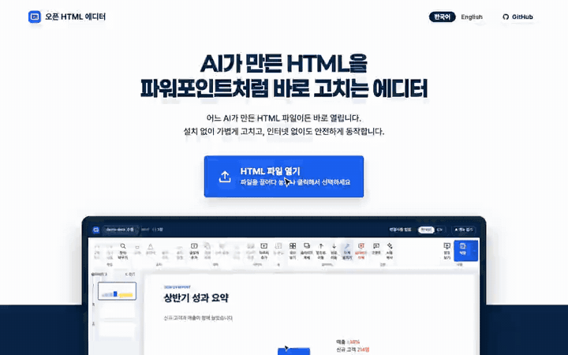

# Open HTML Editor

> Edit AI-generated slides and documents visually — as easily as PowerPoint.

AI creates impressive HTML slides, reports, and landing pages in seconds. But tweaking a single typo, swapping an image, or adjusting an awkward margin often means wrestling with code or re-prompting from scratch.

**Open HTML Editor** solves this. Drop any AI-generated HTML into your browser and edit text, images, and layout directly on screen. Zero install, zero login, zero server uploads.

[](LICENSE)
[](https://github.com/ahnbu/open-html-editor/actions)
[](https://easy-html-editor.pages.dev/)
[]()
[]()

---

### [Try it Live: easy-html-editor.pages.dev](https://easy-html-editor.pages.dev/)



---

## Works 100% Offline with Zero Server Uploads

- **No installation or account:** Open the URL, drag and drop your `.html` file (or a folder containing images), and start editing in ~0.16s.
- **Runs entirely in your browser:** The editor itself never sends any network requests. All parsing, rendering, and patching happen locally in browser memory.
- **Fully offline-capable:** Cached via Service Worker. Once loaded, it works without an internet connection. You can also download `public/index.html` (~370KB) and double-click it anywhere.
- **Original file safety:** Saves initially as `filename_edit.html` without overwriting the original. Once you use "Save As", subsequent saves write directly to that chosen file.

---

## What It Does vs. What It Doesn't Do

| What Open HTML Editor Does | What It Intentionally Does Not Do |
|---|---|
| **Edit AI-generated HTML visually:** Double-click text to edit, format font size/color/alignment/bold, add text boxes, clone/delete/reorder/align objects (6 directions), swap/add images, edit table rows/columns, find and replace, undo/redo. | **Generate new HTML from scratch:** We focus purely on visual modification, not creation. |
| **Auto-detect presentation vs. document:** Automatically recognizes 16:9 slides, vertical A4 documents, resumes, and continuous scrolling sections without manual mode switching. | **Convert or export to PPTX:** AI is HTML-native; we keep workflows lightweight in pure HTML. |
| **Presentation mode:** Multi-slide grid overview, slide duplicate/delete/reorder, full-screen audience presentation (multi-monitor aware), and presenter view with speaker notes, timers, and next-slide previews. | **Require an MCP server:** We provide instant clipboard copying instead of multi-step MCP configurations. |
| **Pin comments & AI prompt export:** Click anywhere to leave revision pins. Click "Copy for AI" to copy the file, comments, and instructions ready for Claude or ChatGPT. Files >200KB copy comments only (with file attach prompt). | **Require accounts or cloud storage:** No login, no telemetry, no tracking scripts, no database. |
| **Bilingual UI:** Korean and English interfaces, auto-detected from browser language with a quick toggle in the top bar. | **Heavy framework overhead:** Built in lightweight vanilla JS bundled into a single standalone file. |

---

## Hand Off Revisions to AI (Optional Skill)

While you can fix small typos and layout shifts directly, larger structural rewrites are best handled by your AI agent.

### 1. Default: One-Click Copy for Any AI
Click **Copy for AI** in the editor toolbar. Open HTML Editor packages your entire HTML document (or comments if >200KB) and numbered comment pins into a structured prompt. Paste it directly into Claude, ChatGPT, or Gemini.

### 2. Optional: Install the Local AI Skill
If you use Claude Code or local AI agents, install our lightweight companion skill (`skills/open-html-editor/`). When you ask *"Apply the comments from the file I just saved"*, your AI agent reads the embedded comments, creates an automatic backup in `_편집백업/`, modifies the file directly, and removes the comment block. No server required.

**Install options:**
- **Via npx skills:**
  ```bash
  npx skills add ahnbu/open-html-editor
  ```
- **Via Claude Code Plugin:**
  ```bash
  /plugin marketplace add ahnbu/open-html-editor
  /plugin install open-html-editor@open-html-editor
  ```
- **Via Prompt in Chat:**
  > "Please read https://github.com/ahnbu/open-html-editor/tree/main/skills/open-html-editor and install this skill."

---

## Security & Privacy (Factual Limitations)

We believe in complete transparency about privacy boundaries:

1. **Editor Isolation:** Open HTML Editor sends **zero network requests** (verified in automated security tests).
2. **Iframe Sandbox:** The document is rendered inside an iframe enforced with a strict Content Security Policy (CSP) blocking `fetch`, `XMLHttpRequest`, `WebSocket`, `sendBeacon`, and HTML form submissions.
3. **Known Limitation:** External images, CDN web fonts, stylesheets, and scripts are allowed to load because modern AI HTML relies heavily on CDNs (e.g., Tailwind, Google Fonts). Therefore, untrusted HTML code could theoretically leak information via image query parameters.
4. **Safety Rule:** **For untrusted or highly confidential HTML documents, disconnect your internet connection before opening.** The editor works 100% offline.

---

## Contributing

We welcome bug fixes, rendering compatibility improvements for various AI outputs (please attach sample HTML!), translations, and accessibility enhancements.

Please read [CONTRIBUTING.md](CONTRIBUTING.md) for build instructions, testing procedures, and architectural guidelines.

---

## License

Released under the [MIT License](LICENSE).

The landing page animation uses [GSAP](https://gsap.com) 3.15.1 (`src/landing/vendor/gsap.min.js`), distributed under GreenSock's [Standard "No Charge" License](https://gsap.com/standard-license), not the MIT License.
